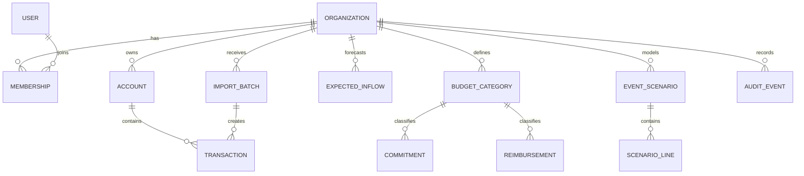

# Database Design

## Design approach

Use a relational database because financial records have strong relationships and consistency rules. Each organization is a tenant. Every tenant-owned row carries `organization_id`; authorization must never rely on a user-supplied organization ID alone.

Money uses `amount_minor BIGINT` (cents for USD) and `currency CHAR(3)`. Store timestamps in UTC and dates in the organization timezone. IDs are random UUIDs. Mutable tables include `created_at`, `updated_at`, and a version for optimistic locking.

## Entity map

## Core tables

### Identity and tenancy

- `users`: id, email (normalized unique), display_name, auth_provider_id, status, timestamps.
- `organizations`: id, name, timezone, base_currency, fiscal_year_start, status, timestamps.
- `memberships`: id, organization_id, user_id, role, scoped_category_id nullable, status, accepted_at, revoked_at. Unique active membership per user/organization/scope.
- `reserve_policies`: id, organization_id, amount_minor, effective_from/to, inclusion_policy, version, created_by.

### Ledger inputs

- `accounts`: id, organization_id, name, type, currency, opening_balance_minor, active.
- `transactions`: id, organization_id, account_id, import_batch_id nullable, external_key nullable, posted_date, description, amount_minor (signed), status, category_id nullable, source, reconciled_at, created_by.
- `budget_categories`: id, organization_id, parent_id nullable, name, code, allocated_minor nullable, owner_membership_id nullable, active. Unique code per organization.
- `commitments`: id, organization_id, category_id, description, amount_minor, currency, due_date, status, confidence, evidence_note, approved_by/at nullable, paid_transaction_id nullable, created_by, version.
- `expected_inflows`: id, organization_id, category_id nullable, source_type, counterparty_label, amount_minor, currency, expected_date, confidence_status, evidence_note, received_transaction_id nullable, created_by, version.
- `reimbursements`: id, organization_id, requester_user_id, category_id, amount_minor, currency, purchase_date, purpose, status, receipt_file_id nullable, exception_reason nullable, approved_by/at nullable, paid_transaction_id nullable, version.

### Imports and files

- `import_batches`: id, organization_id, import_type, original_filename, file_hash, mapping_json, status, row counts/totals, uploaded_by, confirmed_at. Unique organization/type/file_hash for completed batches unless explicitly superseded.
- `import_rows`: id, batch_id, row_number, raw_json, normalized_json, validation_status, errors_json, duplicate_of_id nullable. Retain only as long as policy requires.
- `files`: id, organization_id, storage_key, original_name, content_type, byte_size, checksum, malware_scan_status, uploaded_by, retention_expires_at. Never store raw file bodies in the database.

### Decisions and traceability

- `event_scenarios`: id, organization_id, name, horizon_date, reserve_policy_id, status, decision, rationale, decided_by/at, created_by, version.
- `scenario_lines`: id, scenario_id, case_name (`best|expected|worst`), direction, line_type, label, amount_minor, occurrence_date, confidence, source_record_type/id nullable.
- `calculation_snapshots`: id, organization_id, scenario_id nullable, horizon_date, policy_version, input_digest, components_json, result_minor, calculated_at. Snapshots explain historical decisions; live dashboards are recalculated.
- `audit_events`: id, organization_id, actor_user_id nullable, action, entity_type, entity_id, occurred_at, request_id, ip_hash nullable, change_json, metadata_json, integrity_version. Append-only and partitionable.

## Important constraints

- Amounts are positive where direction/status supplies meaning; transaction amounts are signed. Currency must match the organization in MVP.
- Approval and payment actor cannot be inferred from the current user after the fact; store them explicitly.
- A reimbursement/commitment can link to at most one payment transaction in MVP.
- State transitions use database checks plus service-layer rules.
- Foreign keys include tenant-safe validation; composite `(organization_id, id)` keys are preferred for tenant-owned relationships.
- Sensitive hardship details are outside the MVP. If later added, isolate them in a separately permissioned and encrypted table, never audit their plaintext.

## Derived values

Do not store “current balance” or “safe to spend” as editable facts. Calculate balances from reconciled transactions and safe to spend from versioned inputs. Cache for speed only with an input digest and calculation timestamp. This avoids contradictory totals.

## Indexes and retention

Index tenant plus common filters: `(organization_id, posted_date)`, `(organization_id, status, due_date)`, `(organization_id, category_id)`, and `(organization_id, occurred_at)` for audit. Define retention with pilot institutions before launch; suggested starting point is raw import rows/files 90 days after successful normalization, receipts seven years only if counsel/accounting policy requires it, and audit metadata seven years—subject to institutional and legal review rather than hard-coding assumptions.
