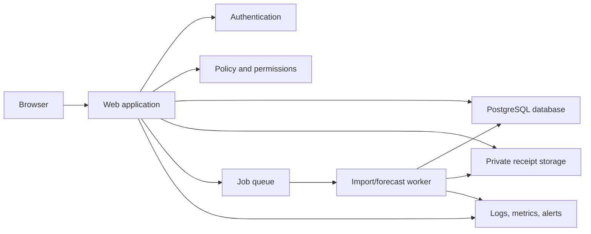

# Application Architecture

## Recommended shape

Start with a **modular monolith**: one web application, one background worker, one relational database, and private object storage. “Modular” means imports, forecasts, reimbursements, access control, and audit each have clear boundaries. “Monolith” means they deploy together, which is simpler for a first team to operate than microservices.

The exact vendor stack remains an implementation decision. A practical default is a typed web framework, PostgreSQL-compatible database, managed authentication with MFA support, private S3-compatible storage, and a managed job queue.

## Modules

- **Identity/organizations:** users, invitations, memberships, roles, session revocation.
- **Import:** upload quarantine, file validation, mapping, preview, normalization, deduplication, atomic commit.
- **Finance records:** accounts, transactions, categories, commitments, inflows, reimbursements.
- **Calculation engine:** pure deterministic functions producing components and results from dated inputs and a versioned policy.
- **Forecast/scenarios:** timelines and alternative assumptions; never writes to official records without explicit conversion.
- **Audit/export:** append-only events and asynchronous export bundles.
- **Notifications (limited):** invite and reimbursement status notices; no collections automation in MVP.

## Request and import flow

Every request authenticates the user, resolves organization membership on the server, applies role and category scope, validates input, performs one transaction, appends audit events, and returns a redacted response.

Imports are asynchronous after upload: quarantine and scan; parse into staging rows; validate and detect duplicates; present preview; then an authorized confirmation commits normalized records atomically. The original upload is private and expires under retention policy.

## Calculation boundary

The calculation engine receives normalized immutable inputs, horizon, currency, timezone, and policy version. It returns a component list, result, warnings, and input digest. It performs no database writes and calls no AI model. This makes results repeatable and easy to test.

## Environments and delivery

- Separate local, test, staging, and production environments with separate secrets and databases.
- Infrastructure and schema changes are reviewed and reversible; migrations back up before destructive changes.
- CI runs formatting, type checks, unit/integration tests, migration checks, dependency/security scans, and permission tests.
- Production uses encrypted backups, point-in-time recovery where available, health checks, error alerts, and redacted structured logs.
- Seed/demo data is synthetic. Production data never enters developer fixtures or analytics tools.

## Future integration seam

Define import adapters that output the same normalized records. Later bank or dues connectors can use that interface without changing calculations. Connector tokens must be encrypted, narrowly scoped, revocable, and isolated from application logs.

## Why not microservices or AI first?

Microservices create deployment, networking, and data-consistency work before the pilot has scale. AI is inappropriate for core arithmetic because the result must be exact and reproducible. Both can be reconsidered only when measured needs justify them.
